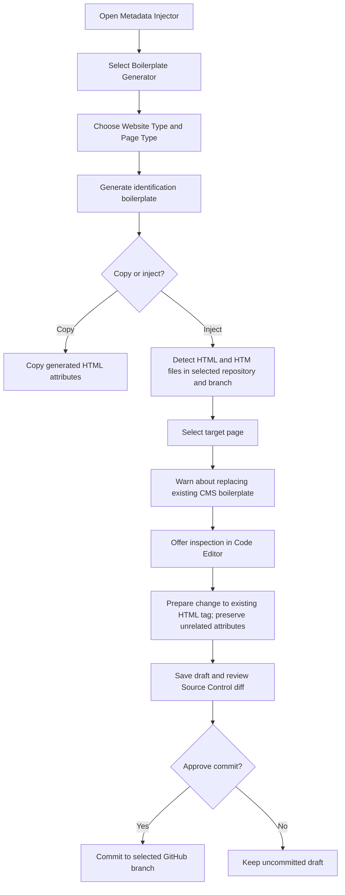
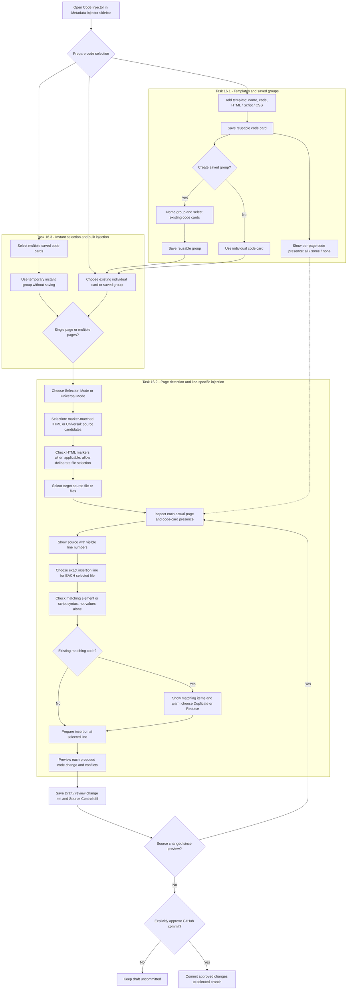

# Luxraj CMS — Development Roadmap

> **For the project owner.** This is a human-readable progress and verification guide, **not a Codex prompt or an implementation specification**. The approved requirements, architecture decisions, and metadata catalogs remain in [README.md](./README.md).
>
> **Status, November 25, 2026:** **Tasks 0–16, P-1 Universal File Manager, Website Controls and the Code Editor redesign are completed and owner-accepted.** Revised Tasks 17–18 are agreed planning, implementation pending. Tasks 19–20 await separate roadmap decisions; Task 21 remains discussion only.

**Website Controls / HTML Sandbox** is implemented, deployed and owner-accepted. See the [owner-approved specification](docs/Luxraj_CMS_Website_Controls_Codex_Plan.md) and [application bridge guide](docs/website-controls.md).

## What we are building

Luxraj CMS is a browser-based system for managing multiple GitHub repositories and branches. It will use a **modular React + TypeScript + Vite frontend**, a **Monaco-based code editor**, and **Supabase** for authentication, secure backend operations, preferences, and drafts.

**Our order of work:** First create a working, secure CMS foundation. Then add agreed feature modules, beginning with Boilerplate Generator and Code Injector. We will use **Codex in VS Code to implement approved tasks**, while the owner reviews the results and decides when to advance.

Tasks 0–16 and the additional unnumbered completed work form the accepted baseline. Revised Tasks 17–18 are next; Tasks 19–20 are awaiting separate decisions, and Task 21 remains outside the approved roadmap.

## Progress at a glance

| Milestone | Tasks | Goal | Current status |
| --- | --- | --- | --- |
| **1. Application Foundation** | 0–3 | Maintainable frontend with routing and readable errors | Completed; owner-accepted |
| **2. Authentication & Security** | 4–6 | Secure login and GitHub App connection | Completed; owner-accepted |
| **3. Repository & Branch Workspace** | 7–9 | Select repositories/branches and browse files | Completed; owner-accepted |
| **4. Code Editor & Source Control** | 10–14 | Edit, save drafts, review diffs, and commit safely | Completed; owner-accepted |
| **5. Boilerplate Generator & Code Injector** | 15–16 | Template identification, source injection and safe review | Completed; owner live-tested |
| **Additional completed work** | P-1, Website Controls, Code Editor redesign | File drafts, reusable HTML sandbox and editor interface | Completed; owner-accepted |
| **6. Users & Communications** | 17–18 | Application assignments, task workflow, chat and Zoho Mail | Revised planning agreed; implementation pending |
| **Future** | 19 | Former dedicated Author Workstation | Awaiting replacement/retirement decision; not implementation-ready |
| **7. Website Preview** | 20 | View the existing live website in permitted workspaces | Awaiting separate roadmap decision |

**Progress rule:** Mark a task complete only after the implementation is working, its checks have passed, and you have personally reviewed the result. Finishing a task does **not** automatically authorize the next one.

---

## Milestone 1 — Application Foundation

**Purpose:** Get Luxraj CMS running locally with the agreed modular React + TypeScript + Vite structure, before connecting sensitive services.

- [x] **Task 0 — Inspect the repository.** Read the existing README and files; establish what is present and what the first implementation change would involve. **Inspection only.**
  - **Your check:** The proposed work matches the approved architecture; nothing has been edited during inspection.
- [x] **Task 1 — Set up React, TypeScript and Vite.** Establish the application entry point, dependencies, build configuration, and basic module layout.
  - **Your check:** The local development server opens the application; the production build succeeds.
- [x] **Task 2 — Add routing and layouts.** Separate the login screen layout from the future authenticated dashboard/sidebar layout. Add navigation structure without pretending authentication works yet.
  - **Your check:** Navigation behaves as expected. No real repository data is exposed to unauthenticated visitors.
- [x] **Task 3 — Shared UI and understandable diagnostics.** Establish genuinely reusable interface components, visible error messages, and initial checks/tests.
  - **Your check:** Common UI looks consistent, errors are understandable, and checks/build succeed.

### Milestone 1 acceptance

- [x] The application starts locally without errors.
- [x] The production build passes.
- [x] Login and dashboard layouts are cleanly separated.
- [x] Core folders are modular, not one giant component.
- [x] You know how to run the site and how to see a useful error message.

**Important:** A visible login screen is not the same thing as secure, working login. That comes in Milestone 2.

---

## Milestone 2 — Authentication & Security

**Purpose:** Make sure only authorized users can access the CMS, and that GitHub credentials are never exposed through the public frontend.

- [x] **Task 4 — Supabase login and sessions.** Implement the approved login-first behavior, logout, session restoration, and protected navigation.
  - **Your check:** Login and logout work. Without a valid login, the dashboard cannot be accessed.
- [x] **Task 5 — Protected Super Admin permissions.** Establish the backend-controlled initial Super Admin identity, authorization checks, and database access restrictions.
  - **Your check:** The approved account is recognized. A non-approved account cannot bypass access rules simply by changing browser code.
- [x] **Task 6 — Secure GitHub App installation connection.** Implement Super Admin-only **Connect GitHub** installation approval, verified backend callback/installation ownership, protected persisted installation ID and status, and short-lived installation tokens minted only by Supabase Edge Functions. Provide Super Admin-only status, selected-repository scope, reconnect and GitHub-side uninstall/revocation controls in Settings; never request a personal access token.
  - **Your check:** Approve selected repositories once, return on another session/device without reconnecting, verify an unapproved user cannot link/unlink or use unauthorized repositories, and confirm Disconnect stops CMS access and actually revokes the GitHub installation (or explicitly reports incomplete revocation). No private key or installation token appears in the frontend.

### Milestone 2 acceptance

- [x] Login, logout, and returning sessions work.
- [x] Backend authorization is actually enforced.
- [x] GitHub credentials remain protected.
- [x] Connection errors can be understood and recovered from.
- [x] You have tested from a second browser/session where practical.

**Important:** Never paste production secrets into source code, the README, or chat prompts.

---

## Milestone 3 — Repository & Branch Workspace

**Purpose:** Navigate and inspect multiple GitHub repositories and branches without mixing their state.

- [x] **Task 7 — Repository selection.** Display accessible GitHub repositories and allow the Super Admin to choose the current repository.
  - **Your check:** You can select between authorized repositories; changing the selection does not require entering a token again.
- [x] **Task 8 — Branch selection and saved preferences.** List allowed branches, switch the current branch, and remember the last selected repository/branch for the user.
  - **Your check:** Selected branches are correct and your workspace preferences restore after login.
- [x] **Task 9 — Secure file browsing.** Show a file tree and read HTML, CSS, and JavaScript files through authorized backend operations.
  - **Your check:** The displayed contents match the selected repository and selected branch.

### Milestone 3 acceptance

- [x] Two test repositories can be selected safely.
- [x] Switching branches changes the files being viewed.
- [x] Workspace preferences persist for the appropriate user.
- [x] No inaccessible repository/branch is revealed or read.
- [x] No accidental edits occur during file browsing.

**Important:** Use safe test repositories/branches for development checks; do not assume the live Luxraj Blog repository's folder layout.

---

## Milestone 4 — Code Editor & Source Control

**Purpose:** Reach a functional **core CMS**: inspect remote source, edit it, save an uncommitted draft, review changes, and explicitly commit to the intended branch.

- [x] **Task 10 — Monaco code editor.** Integrate Monaco to read and display HTML, CSS, and JavaScript files. Begin with read-only viewing.
  - **Your check:** Syntax highlighting and displayed file contents are correct.
- [x] **Task 11 — Editing and drafts.** Enable editing, unsaved-change indicators, and Supabase-backed draft storage without modifying GitHub.
  - **Your check:** Make a small change, save the draft, reopen it, and confirm the GitHub file is unchanged.
- [x] **Task 12 — Shared Change Set and diff viewer.** Track original versus proposed content and display exact changed files and lines in Source Control.
  - **Your check:** You can identify every proposed modification before committing.
- [x] **Task 13 — Safe GitHub commits.** Commit only after explicit confirmation, with backend authorization and checks against unexpected newer changes.
  - **Your check:** A test change reaches the correct branch only; stale/conflicting changes do not silently overwrite others.
- [x] **Task 14 — History and committed diffs.** Browse commits and inspect file-level changes, including changes made outside the CMS.
  - **Your check:** You can locate your test commit and compare its code-level differences.

### Tasks 13–14 — agreed interface destination and verification plan

**Where these features live:** Keep the existing Code Editor's three-pane layout unchanged: **Files (left) | Monaco editor/diff (center) | Source Control (right)**. Add **Changes** and **History** views/tabs inside the existing, collapsible **right Source Control panel**; no new top-level page is needed for either task. Maintain the existing Source Control route and do not break unsaved buffers or drafts. Full implementation guidance is in README §6.

**Task 13 — Changes/Commit:**

- [x] Keep saved changed-file review and open the selected draft diff in the current **center editor**, not in another page.
- [x] Add commit message and **Review & Commit** beneath changes. Show final confirmation with repository, branch, exact filenames, and message; Cancel never writes.
- [x] Backend-only GitHub App commit verifies Super Admin, authorized repository/branch, draft/file base versions, current remote files and branch head. Reject stale/conflicting or protected-branch writes safely; never silently overwrite or partially commit a change set.
- [x] Commit only the confirmed files to the confirmed **test branch**; show commit SHA/link. Preserve saved drafts in Draft Management (including committed drafts), and do not discard unsaved browser edits.
- **Your check:** A commit reaches exactly its intended test branch, the other branch remains unchanged, cancel writes nothing, conflicts stop the commit, and drafts remain available for manual management.

**Completed setting:** Super Admin **Settings → Maximum Files Per Commit** supports **1–100**, default **20**, with frontend and backend enforcement. The live configured value may differ. It limits files per commit, not drafts prepared.

**Task 14 — History/Git Commit Graph:**

- [x] The right-panel **History** tab displays a **Git Commit Graph**, similar to VS Code's graph: commit dots, colored graph lanes, actual parent/merge/split lines, accurate known branch labels, and compact messages/authors/dates/SHAs. Do not invent graph branches or local refs.
- [x] Scope the graph to the active repository/branch; provide refresh and load-more/pagination. Include GitHub commits made **both inside and outside the CMS**.
- [x] Selecting a commit reveals its changed files. Selecting a file opens that commit's **before/after Monaco code diff in the center editor** while preserving any unsaved draft buffers.
- [x] History and diff operations must enforce backend authorization; represent additions/deletions/renames/merges and unavailable/binary diffs honestly.
- **Your check:** Find the Task 13 test commit and an external GitHub/VS Code commit, select both, inspect the actual file/line diffs, and verify the graph accurately represents a real merge when present.

**Combined verification:** Test commit confirmation/cancellation, race conditions, authorization, and branch isolation; then follow the resulting commit through History → changed files → committed diff without altering the editor's active workspace. **Tasks 13–14 are recorded as completed in the owner-accepted baseline; the described scenarios remain regression checks rather than claims every possible edge case has been individually retested.** Planning text does not authorize implementation or deployment.


### Milestone 4 acceptance — **Core CMS ready**

- [x] Open a GitHub file in the CMS.
- [x] Edit it without immediately changing GitHub.
- [x] Save and reopen a draft.
- [x] Review the exact diff.
- [x] Approve a commit to a **test branch**.
- [x] Confirm another branch is unaffected.
- [x] Inspect the resulting commit in CMS history.
- [x] Confirm a conflicting newer version is detected safely.

**Gate:** Tasks 15–20 must reuse the shared edit/draft/diff/commit workflow. The accepted implementation baseline now covers Tasks 0–16; future binary-file work must preserve the trusted Source Control safeguards.

---

## Milestone 5 — Boilerplate Generator and Code Injector (Tasks 15–16)

**Original approved planning source:** [Portfolio living plan](https://github.com/LuxrajKayal/luxraj-portfolio/blob/main/Luxraj_CMS_Revised_Metadata_Injector_Living_Plan.md) for agreed task wording; [`docs/Luxraj_CMS_Working_Sheet_Config.json`](./docs/Luxraj_CMS_Working_Sheet_Config.json) in this repository for Task 15 website/page category configuration. The task definitions below are copied from that document and replace the superseded eligibility/page-type/placeholder sequence. These tasks build on the existing reviewed draft, Monaco diff, and explicit GitHub commit system. Planning is not implementation authorization.

## Task 15 — Boilerplate Generator

**Status: [x] Completed and owner-accepted (November 23, 2026).**

### Location and navigation
- Clicking **Metadata Injector** (Now will be Code Injector) in the primary CMS sidebar opens its viewport.
- That viewport enables a new, feature-specific sidebar.
- The first item in the new sidebar is **Boilerplate Generator**.

  

### Generator
1. Present dropdowns to choose **Website Type** and **Page Type**.
2. Produce a copyable HTML boilerplate based on those selections.
3. The boilerplate identifies the page for later CMS discovery, using the agreed structure:

```html
<html lang="en"
      data-cms-seo="true"
      data-cms-website="blog"
      data-cms-seo-type="BlogPosting">
```

The above category and page type are examples; actual attributes reflect selected dropdown values. The generator provides a **Copy** action.

### Repository discovery and targeted injection
4. Below the copyable boilerplate, offer **Detect all HTML/HTM files from the repository**.
5. Fetch `.html` and `.htm` files from the **currently selected GitHub repository and branch** and show a list of discovered HTML pages.
6. Let the user select a particular discovered page and click **Inject**.
7. The injection process modifies the selected file's **existing opening `<html>` element** with the generated identification attributes, rather than inserting a duplicate `<html>` element or corrupting the document structure. Preserve unrelated HTML attributes and surrounding code.
8. Warn the user before injection that the operation may **replace any previous CMS boilerplate** on that page.
9. Offer the user the option to **open the file in the existing Code Editor** to inspect the HTML before proceeding.

### Existing project-wide change-control requirements retained
- The injection action prepares a proposed code change; it must follow the already established shared draft, Source Control diff/review, and **explicit approval before GitHub commit** process.
- Operations stay scoped to the selected repository and branch.
- Do not automatically edit unrelated files.

### Superseded approach
- The earlier Task 15 requirement that the user must manually paste identification attributes is replaced by **copy OR CMS-assisted injection**, at the user's choice.
- The earlier prohibition on the CMS injecting the identification boilerplate is superseded for this specific, explicitly user-triggered Task 15 action.


**Task 15 JSON implementation reference:** The configuration is now maintained in the Luxraj-CMS repository at [`docs/Luxraj_CMS_Working_Sheet_Config.json`](./docs/Luxraj_CMS_Working_Sheet_Config.json). Use its `website_categories`, `page_categories`, and `generator` data for the Task 15 website/page selection and boilerplate generation. The portfolio living plan remains the planning source; the former portfolio-root JSON path is superseded.

## Task 16 — Code Injector (completed; three segments)

**Status: [x] Completed, deployed and owner-tested live (November 23, 2026).**

**Location:** **Code Injector** is the second option in the Metadata Injector viewport's dedicated sidebar, after **Boilerplate Generator** (Task 15). This feature has a main code preview/editor area and a right-side control window. Code Injector uses the identification boilerplate created in Task 15; it does not decide page categories from directory or file names.

### Task 16.1 — Right Control Window: Code Templates and Saved Groups

**A. Save an individual code template**
1. In the Code Injector's **right control window**, click **Code Template → Add**.
2. Enter a **name** for the code template.
3. Paste or write the **code to inject** in a text box.
4. Choose its **code type** from the dropdown: **HTML**, **Script**, or **CSS**.
5. Click **Save**.
6. Display the saved code as a **compact/narrow card** showing its **name**, **code type**, and **number of code items** in the saved block. The counting rule for nested or multi-element code remains to be finalized; a line does not necessarily equal one item.
7. Retain the individual code template for later selection and reuse.

**B. Create a reusable saved group**
1. In the same right control window, choose **Create New Group**.
2. Enter a **group name** (for example, `SEO Code` or `Schema Code`).
3. Select the **existing saved code templates/cards** that belong in the group.
4. Click **Save**.
5. The resulting group is a **reusable bulk-injectable template collection**. Users can select either a **single code template** or a **saved group** in the injection workflow. Group membership does not erase or combine the original saved code templates.

**C. Presence-aware code cards**
- Code template cards in the right control window show match status **against the currently selected source file**, regardless of its supported text-based file extension; update statuses when the selected file changes.
- **Green tick:** all elements/script items represented by the card already match the selected file.
- **Blue tick:** some, but not all, of the card's items match the selected file.
- **No tick:** none of the items match the selected file.
- Saved-group status is determined from its constituent code templates/items under the same complete/partial/none principle.
- A presence indicator means **matching code is present**, not that its current values are SEO-correct.

### Task 16.2 — Detect Matching Pages and Source Files, Select a Code Line, and Inject

**A. Select and detect target pages or source files**
1. Open **Code Injector** and its main code preview/editor interface.
2. Choose **Selection Mode** or **Universal Mode**.
3. **Selection Mode:** choose JSON-defined **Website Type** and **Page Type**; Detect returns only HTML/HTM pages with Task 15 CMS eligibility and matching `data-cms-website` and `data-cms-seo-type` markers.
4. **Universal Mode:** Detect finds repository source-file candidates without website/page selection or HTML markers; includes unmarked HTML and other supported text source files.
5. Changing mode clears stale discovery results. Do not infer page types from filenames or apply Selection Mode's HTML-marker requirements to Universal Mode.
6. Let the Super Admin select the intended target source file or files. The saved code block's HTML/Script/CSS type describes the template, **not an extension-based barrier** that prohibits injection into another supported text file. The Super Admin chooses the code and insertion target.

**B. Select code and its exact insertion line**
7. Choose the saved **individual code template** or saved **group** to inject. Temporary instant-group selection is described in Task 16.3.
8. Display the **actual selected file's code in a dedicated code-lines preview window**, with **visible line numbers**. This is an **essential step**, not an optional secondary feature.
9. Let the Super Admin inspect the actual source code and click/select the **exact insertion line/location**. For HTML pages, the visible HTML structure guides placement; for other source files, use their actual displayed lines. Do not impose automatic extension-based restrictions on the Super Admin's choice.
10. Show an **insertion preview** of how the selected code will appear at that chosen line before saving. Use the existing **Code Editor** for detailed inspection/editing where needed; the line-selection window must be usable in the Code Injector workflow itself.

**C. Presence checks, warnings, and saving**
11. Before preparing insertion, inspect the selected file for matching elements or scripts using the selected code template's **element/script syntax**, not its display name and not the current value alone.
    - **HTML example:** if the template contains `<title>...</title>`, detect an existing `<title>` element regardless of its text or placeholder value.
    - **Script/JSON-LD example:** if the template contains schema `"@type": "BlogPosting"`, inspect existing JSON-LD for the matching schema type. The bare occurrence of `@type` alone is **not** proof that the same schema exists.
    - Other script and CSS syntax-aware matching rules remain to be detailed during technical refinement.
12. If a matching element/script exists, show a **warning before injection** and present the user-controlled options **Duplicate** or **Replace**. Do not silently duplicate or overwrite existing code. For multi-item templates, identify which items matched so replacement does not remove unrelated code.
13. If no match exists, allow the user to proceed with the code insertion at the selected line.
14. On confirmation, **Save Draft**, then inspect the proposed result through **Source Control** and explicitly **Commit** to the selected GitHub branch after review. Injection does not commit immediately.

**Implemented workflow:** Choose **Selection Mode** (JSON/marker-matched HTML) or **Universal Mode** (source candidates) → Detect/select intended files → choose individual/saved/instant group code, including the editable **Sample SEO Metadata** template → click exact source line for **inline insertion preview** → resolve warnings → **Save Draft → Source Control Review → explicit Commit**.

### Task 16.3 — Instant Grouping and Bulk Injection

**A. Instant grouping (unsaved)**
1. In the right control window, select **as many existing saved code blocks/cards as desired** for the current operation.
2. Treat this selection as a **temporary instant group**; **do not require a group name** and **do not save a permanent group**.
3. Let the user **inject the currently selected combination immediately through the same preview/line-selection and draft workflow**. The combination is temporary; the original code blocks remain individually saved and reusable.

**B. Bulk injection using groups or instant selection**
- A saved group or temporary instant group provides a way to inject **multiple code blocks together**.
- Support applying selected code blocks or a group to **multiple selected source files**, including identified HTML pages and other supported text-based files, in one bulk operation.
- Inspect **each target file separately** for complete, partial, or absent code matches; update its presence statuses and show conflicts before preparing changes.
- Preserve the **visible code-line preview and deliberate insertion-position selection**. When multiple files are involved, show/check insertion locations against **each actual file** rather than assuming one line number is correct for all files.
- Duplicate/Replace choices must remain explicit where existing matching items are found; bulk mode never implies silent replacement.
- Prepare a **reviewable draft/change set** listing all affected files and code changes. The user reviews the Source Control diffs and explicitly commits the approved change set.

### Shared controls, safety, and unresolved technical details
- All Code Injector actions are scoped to the active **repository and branch** and preserve unrelated source code. HTML-only boilerplate generation remains Task 15; Task 16's code injection is not limited by the target file extension.
- Source edits from single templates, saved groups, or instant groups use the existing **Save Draft → Source Control diff/review → explicit GitHub commit** workflow. The existing 20-file-per-commit limit becomes a **Super Admin Settings** value, adjustable from **1 to 100 files**, with **20 as the default**. This setting controls how many reviewed files can be included in one commit, not how many files Code Injector can detect or prepare as drafts. The trusted backend must enforce the selected limit; all current commit safety checks remain.
- If the selected source file changes between preview and commit, revalidate it rather than using stale code-line positions or overwriting remote updates.
- The exact counting definition for **number of items** on a code card, advanced CSS/script syntax matching, and edge cases for conflicts inside large multi-item groups will be defined in later technical planning. These details do not change the requirement for user-selected code-line insertion.
- Task 16 is implemented and owner-accepted; any further changes still require separate authorization.


### Milestone 5 acceptance

- [x] Task 15 generates website/page-specific identification boilerplate and prepares optional reviewed HTML attribute injections without overwriting unrelated attributes.
- [x] Task 16 supports Super Admin-selected text-source targets, exact code-line selection, preview, syntax-aware presence warnings, groups, bulk drafts, and reviewed commits.
- [x] The Super Admin's **Maximum Files Per Commit** setting supports **1–100** files, default **20**, with backend enforcement; preparing more drafts than this limit is permitted.
- [x] All proposed changes remain uncommitted until explicit Source Control confirmation.

---

## Prerequisite P-1 — Universal File Manager (completed; owner-accepted)

**Owner decision: Luxraj Kayal (Subrata), November 23, 2026.** See the full, binding planning specification: [Universal File Manager Prerequisite](./docs/Luxraj_CMS_Universal_File_Manager_Prerequisite.md). P-1 is **unnumbered and must be implemented and owner-accepted before Task 17**; do not renumber Tasks 0–20.

- Create a **separate Super Admin File Manager**, without requiring Code Editor/Monaco, for **any file type** (Word DOC/DOCX, PDF, PNG/JPG/WebP and other images, Office documents, archives, unknown binaries, text and source files), within actual storage, security and platform limits. Support new files, replacements and multiple uploads.
- Stage raw file bytes as private **Supabase Storage drafts** with protected PostgreSQL metadata; display new/replacement status, sizes and hashes and save/reopen drafts without changing GitHub.
- **Viewer integrations are already decided by the owner:** **PDF.js / pdfjs-dist** for PDF page previews and **Mammoth / mammoth + DOMPurify / dompurify** for sanitized DOCX previews. Use native safe image/media previews; legacy Word DOC, ODT and other unsupported/unsafe file types use **metadata/hash/download fallback**. All formats can be drafted and committed even if they have no rich preview.
- Feed file drafts into the existing **Super Admin-only Source Control review and explicit GitHub commit** with branch/version checks and current **1–100 files-per-commit** setting. Do not invent a separate commit system or loosen code-editor safety.
- **Settings → Author Profile Picture Location:** Super Admin selects **one authorized GitHub repository, branch, specific assets folder and public URL prefix** for **all approved Author/Owner profile pictures**. Approved WebP files are staged through P-1; the owner explicitly commits the website copy.
- Super Admin can self-manage their own profile and access **Owner/Admin, Author and Developer** capabilities from a single account, without regular Author approval gates; explicit GitHub commit protections remain compulsory.

**Acceptance:** Implemented, deployed and owner-tested; prerequisite satisfied.

---

## Additional completed work — Website Controls / HTML Sandbox and Code Editor redesign

- [x] **Website Controls / HTML Sandbox:** registered repository/branch-scoped monolithic HTML applications, isolated execution, Internal mode repository file picker and draft outputs, Local mode native file selection/download, explicit output destinations and shared Source Control review. Owner verified the live workflow. See [specification](docs/Luxraj_CMS_Website_Controls_Codex_Plan.md) and [bridge guide](docs/website-controls.md).
- [x] **Code Editor redesign:** VS Code-inspired activity bar, collapsible Explorer/Search/Source Control/History/Settings, tabs and breadcrumbs, status bar, optional right-side review, preserving Monaco, drafts and the existing reviewed commit workflow. Owner accepted; baseline commit `7a68e67`.

## Milestone 6 — Users & Permissions and Communication (Tasks 17–18)

## Task 17 — Users & Permissions Control (revised and owner-agreed, November 25, 2026)

**Status:** Planning complete; implementation pending. This replaces the entire former Task 17 and incorporates the retained profile requirements of the former Task 18.

### 17.1 — User account management

- Use the existing **Users & Permissions** section. Super Admin may still create accounts manually in Supabase, but must also be able to create and manage them from the CMS via **Add New User** and **Modify Existing User** forms. Manually created accounts must be available for Super Admin management.
- Add New User fields: full name, date of birth, gender, educational qualifications, user role (dropdown: Author, Developer, Advisor), user description, login email and assigned password.
- Super Admin assigns the credentials and manually sends them and relevant information to the user by email. No automatic credential delivery, public registration or user-initiated password reset. The CMS never retains readable passwords or exposes them in logs or settings; Supabase Auth stores only the password hash needed for authentication. Passwords are supplied at account creation, not displayed later.
- Modify Existing User allows the Super Admin to update assigned fields and role or explicitly delete the user completely. Account/profile records are independent of ordinary Settings, preference and draft cleanup; only the authorized Users & Permissions deletion action removes a user/profile. Backend authorization applies to account creation, modification and deletion.
- Users log in with the assigned email and password. The first-login profile form displays the admin-assigned fields already populated, greyed out and read-only. Only the profile picture is user-editable.
- Retain WebP-only profile picture uploads, 15–150 KB inclusive, no CMS conversion/compression; recommended square image and circular avatar. Store pending image privately in Supabase. Super Admin reviews, approves or returns it with comments; approval stages the website copy through P-1 using Settings → Author Profile Picture Location (authorized repository, branch, assets folder and public URL prefix). Explicit Source Control commit is required before claiming the website copy is available. Keep the previously approved profile image active until the replacement is approved and its required website copy committed. Subsequent changes follow the same process.

### 17.2 — Role-based workspaces and HTML application assignments

- Author, Developer and Advisor have their own restricted working areas, separate from the Super Admin dashboard, sidebar, privileged tools and management controls. Enforce permissions on backend operations and direct URLs, not merely visible navigation. Super Admin retains full administrative control.
- In Users & Permissions, the Super Admin assigns one or multiple existing monolithic HTML applications to an individual user; can remove or change assignments. The assigned applications determine the tools available, regardless of their internal purpose. The CMS does not interpret application-specific logic or output.
- The user's Workstation is enabled only if at least one application is assigned; removing all assignments disables it and revokes access. Existing accounts, drafts and task records are not deleted by removing an application. No Hold/Resume user workflow.
- Reuse the existing Website Controls sandbox as a restricted workstation, without Super Admin application-management, unrestricted repository, credential or publishing privileges. All file access and draft operations are scoped and backend-authorized. Assigned applications must not acquire broader permissions through their code or bridge.
- The owner may maintain separate HTML applications for Authors, Super Admin, or other roles. The CMS is unaware of their internal roles or functionality. A regular user's application produces an output; the Super Admin can open that output as input in a different Admin application in the existing sandbox, verify or manipulate it and prepare final output. File formats and compatibility are defined by the applications, not the CMS. The sandbox and shared draft system handle the files generically.

### 17.3 — Task assignment and submission

- Super Admin creates a task in Users & Permissions: select an existing user from the dropdown, enter task type and description, and automatically generate a Task ID in the exact format `TSK-DD-MM-YYYY-HH-MM` (24-hour time), e.g. `TSK-25-11-2026-16-33`. No seconds or extra visible identifier at present; reject duplicate IDs rather than overwrite a task.
- Assigned tasks appear in the corresponding user's workspace as **Pending**. Tasks do not grant access to unassigned applications. A user generates work in an assigned application and saves its output as a private draft in Supabase. On submission, choose the associated assigned Task ID from a dropdown. Preserve the same ID on corrections and resubmissions; do not interpret the file content.
- The task becomes **Submitted for Review** and the Super Admin receives a notification identifying the user, role, Task ID and submitted draft. Super Admin opens the submitted output as input in their own sandbox application, reviews/processes it and prepares the final file(s) through the existing shared draft and Source Control workflow.
- Super Admin may **Reject** or **Return for Correction** with a simple comment. Returned work may be corrected and resubmitted under the same Task ID. Super Admin can terminate any task; termination is a distinct **Terminated** status, not deletion of records, drafts or committed files. No legacy Hold/Resume or separate cancellation workflow.

### 17.4 — Commit-based completion and permanent Git history

- **A successful associated GitHub commit is the only way to mark a task Completed.** There is no manual Complete or separate Approve action. Authors, Developers and Advisors all follow this rule; recommendations and advisory work are committed as documentation to the chosen authorized repository/branch.
- Maintain the Task ID association through submission, Admin application processing, final draft(s) and Source Control. Automatically include the associated ID in the existing commit message (e.g. `[TSK-25-11-2026-16-33] Added advisor recommendations`); Super Admin supplies the normal descriptive message. The existing GitHub commit history/CMS History panel is the permanent commit record; no separate record-keeping module. Maintain the task's status and successful commit association in Supabase.
- Task statuses: **Pending → Submitted for Review → Completed** (only on successful associated commit), **Rejected**, **Returned for Correction** (resubmit under the same ID), or **Terminated**. Failed, cancelled or unrelated commits and saved drafts do not complete tasks. Ordinary users cannot commit directly.

### Task 17 acceptance

- [ ] Super Admin can add, modify and delete users; ordinary settings cleanup does not delete accounts/profiles; login works without exposing passwords.
- [ ] First-login profile is read-only except WebP upload; approved website asset uses P-1 and explicit commit.
- [ ] Assigned sandbox applications are accessible only to authorized users; unassignment disables access; roles cannot bypass backend restrictions.
- [ ] Create task, save output, select Task ID, submit, notify Admin, open output in Admin application, reject/return/resubmit/terminate as appropriate.
- [ ] Successful associated GitHub commit includes Task ID and alone triggers Completed; failure/cancellation does not.

## Task 18 — Communication & Email Management (revised and owner-agreed, November 25, 2026)

**Status:** Planning agreed; implementation pending. The former dedicated Author Homepage, profile form, dashboard and article-specific tracking plan is retired. Profile fields and task/draft workflow are covered by Task 17. Retain the agreed chat system and add Zoho Mail integration.

### 18.1 — Internal chat, collaboration, presence and notifications

- Provide Chat in Super Admin and regular-user workspaces. Users can chat with Super Admin and only other CMS users explicitly assigned as collaborators by Super Admin.
- Show Online, Working and Offline presence derived from real CMS connection/activity, not user-set status. Super Admin sees user presence; users see Super Admin online/offline presence. Do not infer activity outside the CMS.
- Persist chat history in Supabase, permit messages to offline recipients, and enforce conversation membership server-side. Only Super Admin may delete chat history.
- In-app unread/message notifications and optional browser/Web Push notifications subject to user/browser permission and subscription. Messages remain stored and accessible without push permission.

### 18.2 — Zoho Mail integration

- Add **Email** to the Super Admin main sidebar. Regular users see Email only when assigned at least one Zoho alias; removing all aliases revokes access. Email access is independent of workstation/application assignment.
- Retrieve confirmed available Zoho aliases dynamically using the existing account's REST API. In Users & Permissions, Super Admin assigns one or multiple aliases and independently controls each user's ability to compose/send (including replies) and delete emails. Super Admin can revoke/reassign access and read, send or reply from any authorized sending address, including the primary account. Users see only emails belonging to assigned aliases and can send only from those aliases when permitted. No Zoho login or credentials exposed to users.
- Simplified Gmail-style interface: compose, inbox, sent, drafts, search, read/reply, relevant folders and attachment visibility/download, with safe previews where supported. Super Admin has full control; regular-user actions follow assigned permissions.
- Use Supabase Edge Functions for secure Zoho OAuth, refresh and API calls; credentials/tokens remain backend-only. Enforce alias/message-level authorization for listing, search, reading, attachments, drafts, sending, replies and deletion. Never trust client filtering or user-supplied From addresses/message IDs. Ambiguous alias ownership (including BCC/forwarding where not reliably attributable) is Admin-only. Zoho remains the primary mail storage/delivery service; avoid permanently duplicating the mailbox in Supabase. Audit actual CMS actor for sending.
- Owner-tested API evidence: 14 successful checks (OAuth, token renewal, account access, alias verification, folders, mailbox reading, alias search, draft creation, send from/to alias, receipt, full content, headers, reply). Attachment information was skipped (no suitable attachment). Verify upload/download, deletion, read/unread, complete export and Zoho's delegated multi-user access terms before implementing/releasing affected features; successful API tests alone do not establish contractual permission.

### 18.3 — Super Admin-only email backup to GitHub

- Super Admin selects individual emails, alias mail or entire mailbox, then chooses any authorized **private** repository, branch, folder/file destination and supported archive format. Suggested formats: EML, JSON, Markdown, HTML, ZIP (not a fixed exclusive list). Preserve subject, sender, recipients, timestamps, headers, body and attachments as supported by the chosen format; do not claim full-fidelity backup where data are omitted.
- Generate archive through P-1 File Manager/shared draft workflow, review exact destination/file via Source Control and explicitly commit. No separate commit system. Verify successful and complete backup before offering explicit Admin-confirmed deletion of original Zoho emails to free storage. Never automatically delete originals or delete on failed/incomplete backup. Restrict access to backups and avoid public repositories.
- **Remaining implementation decisions:** whether permitted regular-user deletion moves mail to Trash only or permanently deletes; whether backup is one-way archive or supports restore into Zoho. No default behavior is assumed until decided.

### Task 18 acceptance

- [ ] Chat membership, presence, stored offline messages, Admin-only deletion and notifications work.
- [ ] Super Admin can assign/revoke aliases and compose/delete permissions; regular users cannot access unassigned mail or send from another address, even via direct API calls.
- [ ] Verified Zoho email operations, attachment visibility/download, and scoped sending/reply work without exposing credentials.
- [ ] Admin-only backup to authorized private repository uses existing reviewed commit; deletion requires complete verified backup and explicit confirmation when used for mailbox cleanup.
- [ ] Remaining deletion/restore decisions and API/terms verification are resolved before affected functionality is released.

---

## Remaining roadmap decisions — Tasks 19–20

**The following existing Task 19 and Task 20 text is retained temporarily for the owner's next planning discussion only. It is not approved for implementation under the revised roadmap. References to former Tasks 17–18 and legacy Author-specific workflows below are superseded by the revised Tasks 17–18 above.**

## Task 19 — Author Workstation (former plan; awaiting owner decision)

### Task 19.1 — Word-like Article Editor, Template Rules, Validation, and Review

**Workspace and author editing**
- Add an **Author Workstation** item to the Author's role-specific sidebar.
- The Author first **selects an article category** in the Author Workstation and clicks **Create New Article**. The CMS asks Supabase to create an **Author-specific, predefined Markdown draft** associated with that selected category. This working draft is stored in Supabase and **is not yet a GitHub repository file or a published website page**.
- The new draft opens as a **Word-like writing document** in the central workspace with a **requirements/control panel on the right**. The Author works on this template-based Supabase draft, not directly on website repository files.
- Authors compose visually with permitted rich-text controls (headings, paragraphs, emphasis, lists, etc.). Authors **cannot enter or edit raw HTML/CSS**, alter code templates, or choose arbitrary typography. The Super Admin predefines supported elements, text sizes, article structure, and styling to match the target website.
- The predefined Markdown draft stores the article content and populated or pending **metadata, canonical link, breadcrumbs, and template-controlled fields**. The CMS renders the structured draft into preview HTML and later prepares the website HTML from the approved content. Article boilerplate, page type, metadata structure, canonical URL configuration, image dimensions/positions and formatting come from the Super Admin's prepared article template, not Author-written raw HTML.
- When the Author clicks **Create New Article** after selecting the category, the CMS automatically uses the **Blog** website type and the **Article - Blog** page type, with the Task 15 **`data-cms-website="blog"`** and **`data-cms-seo-type="BlogPosting"`** boilerplate. The Author selects the article category, **not** the website/page-type boilerplate.
- Drafts are personalized using the **approved Author name**, **verified committed website-hosted Author image URL** from Task 18/P-1, and their fixed original creation date when that approved identity is available. Private drafts may be saved while profile approval is pending without falsely filling approved identity; Preview/Submit remain gated until required approval and website image commit.
- Record the creation date once when the draft is first created; reopening or editing the draft must not reset it. Track subsequent modification dates separately. The profile data is sourced from the authenticated, approved CMS Author profile rather than manually re-entered by the Author.

**Website category, canonical URL, and breadcrumb generation**
- In the Super Admin **Settings** tab, configure the assigned Blog website's **public base URL, language/URL structure, available article categories, and their approved public paths and repository destinations**. The Author chooses an article category from the Workstation dropdown **before clicking Create New Article**. The CMS associates that category with the Supabase Markdown draft; Authors do not manually construct canonical URLs, breadcrumb paths, or repository destinations.
- Use the **approved website routing and category configuration** to populate the proposed canonical URL and matching breadcrumbs in the Author's Supabase Markdown draft as the required title becomes available. The selected category also determines the **configured destination for eventual website publication**, which the CMS or Super Admin can resolve after editorial approval. **Repository file/route detection** helps verify that destination matches the website structure; do not assume a repository file path always equals its public URL.
- Generate the article slug from **`article-` + the first two words of the entered title + `-` + the draft's creation date in `MM-DD-YY` format**. Lowercase the title words and normalize them to URL-safe hyphen-separated text. Example: title **How to Install Linux**, creation date **November 26, 2026** → `article-how-to-11-26-26`.
- Example of the resulting proposed canonical URL for the **How To** category: `https://blog.luxraj.com/en/categories/howto/article-how-to-11-26-26`. The corresponding breadcrumbs follow the same route: **Home → Categories → How To → Article Title**. This domain and route are examples until approved in Super Admin Settings.
- Populate the draft's background **canonical link** and matching **breadcrumb navigation/structured data** automatically from the same settings, category, and article slug. The canonical URL is a **proposed future public URL** until the article is published.
- Verify **URL uniqueness** before publication because articles with the same first two title words and creation date could collide. Once a published URL is finalized, reopening or editing the article must not regenerate or change it unexpectedly.

**Right-side required inputs and automatic checklist**
- The right panel contains **real mandatory input fields**, not just a checklist: specifically **Title** and **Description**, plus the requirements/counters configured by the Super Admin.
- An Author enters the **Title** in the right panel and presses **Enter**; its value updates the draft's background HTML/title mapping. The **Description** is entered in the right-panel field and likewise maps to its background metadata. These fields can remain incomplete while a private draft is saved; completion is required for submission.
- The Super Admin defines minimum target counts/required ranges for title, description, headings and article content. The UI displays **live character or word counters as appropriate to each configured field** and marks each requirement complete automatically when its threshold is satisfied.
- In the Word-like document, when the Author selects **H1, H2, H3**, etc. and writes text, the corresponding right-panel checklist measures **the actual text within that element**, not just whether a heading tag exists. For a configured H1 minimum of 50 characters, `1/50` is incomplete; `50/50`, `51/50` or more is complete/ticked. Apply the corresponding Super Admin limits to other headings and text content, including overall writing-length requirements.
- Checklist completion is computed from actual entered values and structured editor content; Authors cannot manually mark a failing automatic requirement as passed.
- All mandatory textual fields use their assigned **character/word-based validation**. **Image links are the exception:** no character-count requirement; check that a **direct image URL** has been provided and meets the relevant image-link/placement requirements.

**Images and controlled presentation**
- Authors add article images **by direct image links only**, not by uploading images into the article.
- The Super Admin defines where images may appear, the permitted image slots, and the predefined sizes/dimensions for those positions. The Author inserts an approved direct image URL into those designated slots; the CMS renders the image using the prepared template/layout.
- The Author enters the **hero image's direct URL once** in its designated field. The CMS automatically maps that single value to the visible hero image, **Open Graph `og:image`**, **X/Twitter `twitter:image`**, applicable **JSON-LD image fields**, and other image metadata required by the existing article template. The Author does not re-enter the same URL in each SEO field.
- **BlogPosting schema structure and page type** are automatically initialized during blank draft generation based on the preselected Blog / Article boilerplate. Individual values that are not yet supplied remain unfilled/placeholders until available; **publication date** is not assumed to equal draft creation date.
- Further mapping of the main **Title** and **Description** to other SEO title/description fields remains **undecided** and will be planned separately; do not assume all title or description metadata shares one value.
- Super Admin controls the article's typography and text sizes, rather than allowing Authors arbitrary font sizes or raw style changes.

**Article preview, Save Draft, and Submit**
- The Author can click **Preview** while working on the article. The CMS renders the current Supabase Markdown/template draft as a **preview-only article page in a new browser tab**. This does not create, commit, deploy, or publish a page on the website. The Author can return to the Workstation and continue editing.
- **Save Draft** stores the Author's Markdown working document and its current template fields in **Supabase**, even if required fields, word/character thresholds, images, headings, or other checklist items are unfinished. Drafts remain available for later editing through the Author Dashboard; saving never creates or changes a GitHub website file.
- **Submit to Super Admin** becomes available **only when every mandatory configured requirement is satisfied**. The CMS validates the real underlying input/content, not merely tick icons. A valid submission does not imply Super Admin approval.
- **Submit for Review** stores the completed Markdown draft and its submission state in **Supabase**, then moves the article into Super Admin review; submission does not modify the GitHub repository. The Author Dashboard reflects the article status. For assigned work, preserve the same automatically generated **Task ID**, and allow the Author to include a **submission comment**.
- Upon submission, update the **Super Admin Dashboard's top-right notification area** and the **submission card** in **Users & Permissions / task assignment** (Task ID, Author name, submission time, Author comment).

**Super Admin Author interface and review controls**
- Super Admin has an **Author** sidebar option with the Author writing/review interface **plus Super Admin controls**, without a second Author login, role downgrade or ordinary Author profile approval gate.
- From a submitted-task summary card, the Super Admin opens the corresponding submitted article in this dedicated interface.
- The Super Admin can **mark specific lines, sections, or fields requiring refinement**, enter correction or rejection reasons in comment windows, and choose **Approve**, **Reject**, or **Return for Correction**.
- When returning a submission, synchronize the marked fields/lines and the reasons with the Author's Dashboard and Workstation. The Author edits the returned article and resubmits it for another review under the original Task ID.

**Super Admin-assigned revisions to existing articles**
- The Super Admin can select an **existing article** and assign an update task to an Author, including **comments/instructions** specifying the changes needed. The task appears in the Author Dashboard with its Task ID.
- The Author opens the **existing article** in the Workstation rather than creating a new blank article. Preserve its existing article identity, original creation/publication date, canonical URL, and breadcrumbs unless a separately approved change requires otherwise.
- When the Author submits the revised article, record the **Author's submission date as the proposed updated date** and require the Author to provide an **Update Note** describing the changes for the Super Admin's review.
- If corrections are returned and the Author resubmits, the proposed updated date follows the **latest submission date**. The live article keeps its currently published update date and content until the Super Admin approves the revision and completes the existing Code Editor publication workflow.

**Approval of new articles and edits to existing articles**
- The Super Admin reviews **both new article submissions and updates** submitted by Authors. An Author's edits to a previously approved article must again be **submitted for Super Admin approval**.
- Super Admin outcomes: **Approve**, **Reject**, or **Return for Correction**.
- When returning work, the Super Admin can **mark the precise unsatisfactory items/sections** (e.g., description, specific heading, content or image), with comments. Those marked issues are visible to the Author, who can revise, save drafts, and resubmit.
- Satisfying automatic word/character validation is **not equivalent to editorial approval**; the Super Admin may reject or return content even when counters pass.
- Maintain the existing **approved/published article version unchanged** while an Author's proposed update remains in draft/review and while an approved replacement awaits publication. Approval sends the replacement to Code Editor for the existing publishing process; it does **not** automatically replace the published version.
- Preserve the original creation date; track modification/update dates distinctly. Do not confuse draft modification with the approved/public version's update.
- Article workflow distinguishes **Draft → Submitted → Approved / Rejected**, with **Returned for Correction** leading to editing and resubmission. **Approved** is not the same as **Published**.

**New-article workflow summary**
- **Select category → Create New Article → Supabase creates personalized Markdown draft with template/metadata/canonical data → Write in Word-like Workstation → Preview in new tab → Save Draft or Submit for Review → Supabase notifies Super Admin → Comment/Return/Reject/Approve → Resolve category-based website destination → Prepare HTML → Existing Code Editor and Source Control review → Super Admin commits/publishes.**

**Approved draft handoff to Code Editor and publication**
- When satisfied with the submitted Supabase article, the Super Admin clicks **Approve** in the Super Admin Author review interface. This **does not publish** the draft.
- On approval, the CMS uses the **category saved with the article** and the Super Admin's preconfigured category-to-destination mapping to identify where the website article belongs. It prepares the corresponding **website HTML file/change** from the approved Markdown/template data at that destination. The Author is never asked to manage repository files.
- The prepared publication change becomes available through the existing **Code Editor** section, and a **small red notification dot** appears on the Code Editor sidebar item to draw the Super Admin's attention.
- The **Super Admin**, not the regular Author, opens Code Editor and reviews the generated website HTML and intended repository path through the **existing draft/change-set → Source Control diff → explicit GitHub commit** workflow. When the destination file is new, that existing commit workflow must also support **reviewed new-file additions**; do not introduce a separate publishing or commit system.
- Ordinary Authors retain their Word-like Workstation and **do not gain Code Editor or publishing permissions** through article submission or approval.

### Scope of the decision
- **Already decided by Luxraj Kayal (Subrata):** Task 19's specified Author Workstation pages and functionality are approved, not open questions. Only matters explicitly marked unresolved within Task 19 remain for future decisions.
- Task 19 is a **new** plan and does not reinstate the original repository's superseded Task 19 (Missing-Placeholder Injection).
- Nothing in Tasks 18–19 authorizes changes to GitHub, the repository README/roadmap, Supabase schema/configuration, or deployed CMS until separately requested.

---

## Milestone 7 — Website Preview and Inspection (Task 20)

## Task 20 — Website Preview and Inspection (former plan; awaiting owner decision)

- Provide a **Website Preview** interface accessible to **both Authors and the Super Admin** from their respective CMS working areas.
- Load the **existing live website** within the CMS using an **iframe**, based on the website URL configured by the Super Admin.
- Allow both roles to **navigate existing website pages, refresh the preview, and visually inspect content and layout** to identify problems on the website.
- Authors may **identify visible faults** through this preview; the feature does not grant them source-code, administrative, or publishing permissions. The Super Admin retains their existing authorized controls.
- Embedded viewing depends on whether the target website allows iframe embedding through its **Content Security Policy / frame-ancestors** and **X-Frame-Options** configuration. Do not assume the CMS can access or inspect cross-origin iframe internals automatically.
- **Fault reporting, assignment, or corrective-action workflow is not yet defined**; do not add one without a further planning decision.

### Milestone 7 acceptance

- [ ] Author and Super Admin can navigate and refresh the configured existing live website in their authorized workspaces where iframe embedding is permitted.
- [ ] Preview access does not grant editing, administrative, or publication permissions.

**Later discussion (not part of Tasks 15–20):** Task 21's manually triggered sitemap/site-status concept has not been added to this roadmap as an approved task specification.

---

## How to use this roadmap as project owner

At the end of **each task**, you should have four things:

1. **A visible result:** What changed in the application and where to find it.
2. **A plain-language explanation:** What changed, why it was needed, and how it relates to HTML/CSS/JavaScript concepts you know.
3. **Test evidence:** Which checks passed, which failed, and any limitations.
4. **Your own verification steps:** Something you can try in the browser or VS Code before accepting the change.

After reviewing those items, mark the task complete and separately decide whether to proceed. If a task fails, leave it incomplete until repaired.

### Simple task record

You can copy this block below a task later to record progress:

```text
Task:
Status: Not started / In progress / Needs fixes / Verified
Date:
Git branch or commit:
What I tested:
Result:
Notes:
```

### Project-level safeguards

- Work in small, reviewable changes and use dedicated development/test branches.
- Do not treat "the app builds" as proof that the feature behaves correctly.
- Never approve a commit or deployment solely because an AI agent reports success.
- Never silently change approved metadata selections, security boundaries, or independent category templates.
- Do not move on to a later milestone while its required foundation is broken.
- Keep [README.md](./README.md) as the source for detailed architecture and specifications. **This file is your progress guide**.

---

**Current status:** Tasks 0–16, P-1, Website Controls and the Code Editor redesign are owner-accepted. Revised Tasks 17–18 require separate implementation approval; Tasks 19–20 await owner decisions. Deployment requires separate approval.
